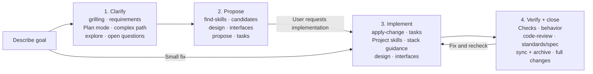

<div align="center">

# AI Workflow

**Carry a clear requirement all the way to verified delivery in Codex.**

[English](README.md) · [简体中文](README.zh-CN.md)

[](https://github.com/shuaibilx/AI-workflow-coding/actions/workflows/ci.yml)
[](LICENSE)
[](skills/ai-workflow/SKILL.md)

</div>

AI Workflow is a Codex skill that connects requirements discovery, technology choices, relevant skills, OpenSpec planning, implementation, and review. It carries decisions between those steps and scales the process to the task.

## Why this exists

Good tools still need handoffs. A thorough interview can become a second interview during planning. A technology skill can arrive after the architecture is decided. A review of committed code can miss the implementation still sitting in the working tree.

This workflow makes those handoffs explicit:

- **Clarify once.** Reuse decisions; explore only the unknowns that remain.
- **Let expertise inform the plan.** Read candidate skills before finalizing the design; install the selected project skills afterward.
- **Keep a single implementation plan.** Carry discovery into OpenSpec artifacts.
- **Verify before closing.** Check behavior, review both standards and requirements, fix defects, then archive.
- **Match the task.** A local, well-understood fix takes the short path.

OpenSpec supplies the change/spec machinery. AI Workflow coordinates it with complementary skills. It is an independent project, initially targeting Codex.

## See the workflow



Plan mode is an optional Codex aid for complex, risky, or underspecified work; it does not create a second source of truth. `openspec-explore` investigates repository facts or feasibility only when questions remain. The OpenSpec proposal carries confirmed decisions, selected skills, and tasks, then waits for your implementation request. Small fixes go straight to implementation and review. Full changes sync specs and archive after checks pass.

| Stage | Skills and tools | Role |
| --- | --- | --- |
| Clarify | `grilling`; Codex Plan mode (optional); `openspec-explore` (optional) | Clarify scope and acceptance; reason through complex paths; investigate unresolved repository facts or feasibility. |
| Propose | `find-skills`; `codebase-design`; `openspec-propose` | Assess candidate skills, shape module interfaces, and create the authoritative proposal and task plan. |
| Implement | `openspec-apply-change`; selected project skills; `codebase-design` | Execute OpenSpec tasks with stack-specific guidance and the agreed interfaces. |
| Verify and close | Checks; `code-review`; `openspec-sync-specs`; `openspec-archive-change` | Verify behavior, review standards and spec, fix and recheck findings, then sync and archive full changes. |

## Quick start

Requires **Codex, Node.js 22.20.0 or newer, npm, and Git**. The installer is designed for Windows, macOS, and Linux; CI exercises the supported systems. Use PowerShell 7 on Windows.

### Install with the skills CLI

```sh
npx skills add https://github.com/shuaibilx/AI-workflow-coding --skill ai-workflow --global --agent codex
```

Then open your project in Codex and start with:

```text
$ai-workflow Set up the missing dependencies and initialize OpenSpec in this project.
Then help me plan a CSV export feature. Ask about material requirements before proposing it.
```

This explicit setup request lets Codex run the bundled installer. The standard `skills add` command installs the main skill and its files; it does not execute dependency-installation hooks.

### Or install the workflow and its global dependencies in one command

```sh
npx --yes --package=github:shuaibilx/AI-workflow-coding ai-workflow install
```

This uses the package directly from GitHub; no separately published npm package is required. It installs the workflow plus missing global skills and OpenSpec CLI, preserving existing dependencies. It leaves project initialization for the project you explicitly select.

### Continue after reviewing a proposal

```text
$ai-workflow Apply the proposal. Include verification, code review, fixes,
spec synchronization, and archive once all completion checks pass.
```

For a small fix:

```text
$ai-workflow Fix this label typo. Keep the scope local and verify the affected screen.
```

For an interrupted task:

```text
$ai-workflow Continue the existing CSV export change from its current state.
```

## What gets installed

The installer adds AI Workflow, missing global base skills (`grilling`, `find-skills`, `codebase-design`, and `code-review`), and the OpenSpec CLI. Project setup and technology-specific skills are handled separately:

| Item | Location / behavior |
| --- | --- |
| AI Workflow and base skills | User `.agents/skills/`; existing legacy `.codex/skills/` dependencies are detected too |
| OpenSpec CLI | npm global; an existing CLI is preserved |
| OpenSpec project files | Initialized only in an explicitly selected project |
| Technology-specific skills | Project `.agents/skills/`, selected during planning |
| Installer ownership record | User `.ai-workflow/state.json`; separate from the skills CLI's own lock |

Third-party skills are downloaded from their original repositories. Their sources and fixed Git commits are declared in [dependencies.json](skills/ai-workflow/config/dependencies.json). We do not vendor their source into this skill.

Existing unmanaged skills are reused and preserved, including during dependency updates. A directory's presence does not establish its provenance or compatibility. The installer records ownership only for dependencies it installs and detects edits before updating managed content.

## Check, initialize, and update

After a global installation, this path works in a POSIX shell or PowerShell:

```sh
node "$HOME/.agents/skills/ai-workflow/scripts/cli.mjs" doctor
node "$HOME/.agents/skills/ai-workflow/scripts/cli.mjs" install --dry-run
node "$HOME/.agents/skills/ai-workflow/scripts/cli.mjs" init --project "/absolute/path/to/project"
```

On Windows, provide a Windows project path such as `C:/work/my-project`. Resolve the actual skill path when using a custom Codex installation or project-scoped skills.

To update the main skill from this repository:

```sh
npx skills add https://github.com/shuaibilx/AI-workflow-coding --skill ai-workflow --global --agent codex
```

Then update the dependencies managed by this installer:

```sh
node "$HOME/.agents/skills/ai-workflow/scripts/cli.mjs" update --dry-run
node "$HOME/.agents/skills/ai-workflow/scripts/cli.mjs" update
```

Default updates use this release's declared versions/commits. Add `--latest` to explicitly resolve current upstream versions; that channel has not been compatibility-verified. No dependency updates run automatically during ordinary development.

After an OpenSpec CLI upgrade, project instruction refresh is a separate deliberate operation (`openspec update` in the selected project). The installer does not silently refresh every project.

## Small entry, focused references

```text
skills/ai-workflow/
├── SKILL.md                    Routing and essential handoffs
├── references/
│   ├── setup.md                Setup, scope, and updates
│   ├── planning.md             Discovery, design, and proposal
│   ├── skill-selection.md      Candidate review and project installation
│   ├── implementation.md       Apply and scope changes
│   ├── review.md               Checks, two-axis review, and closure
│   └── resume.md               Recover the current state
├── scripts/                    Cross-platform installer
├── config/dependencies.json    Versioned dependency sources
└── agents/openai.yaml          Codex UI metadata
```

Codex reads the relevant reference when entering that phase. The entrypoint does not load every procedure or duplicate upstream manuals.

## Boundaries worth knowing

- **Plan mode is host-controlled and optional.** The OpenSpec proposal remains the single durable plan.
- **Explore is optional** when the requirements and implementation approach are already clear.
- **Review coverage is explicit.** Uncommitted and untracked implementation needs supplemental review. Without Git or independent agents, the workflow reports the fallback it actually performed.
- **A passed review is not a passed test.** Completion requires actual evidence appropriate to the change.
- **Publication and deployment need their own instruction.** Finishing a development task does not automatically push or deploy it.

## Development and distribution

```sh
npm test
npm run check
npm pack --dry-run
```

The package has no runtime npm dependencies; it invokes fixed external tool versions when needed. Integration downloads require network access. See [publishing](docs/publishing.md) for release and Skills.sh checks.

The workflow diagram is Mermaid code embedded directly in this README and rendered by GitHub. Keep the English and Chinese diagrams aligned when editing them.

Skills.sh discovers public GitHub skills through normal `skills add` installation telemetry. Search/ranking updates are controlled by that service, and immediate indexing is not guaranteed. See the [official FAQ](https://www.skills.sh/docs/faq).

## Credits and license

Built around [OpenSpec](https://github.com/Fission-AI/OpenSpec), [Matt Pocock's skills](https://github.com/mattpocock/skills), and [Vercel's skills ecosystem](https://github.com/vercel-labs/skills). Their projects keep their own licenses and release cycles.

This project's instructions and installer are [MIT licensed](LICENSE).
