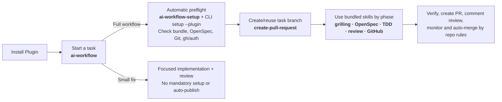

<div align="center">

# AI Workflow Plugin

**Carry a clear requirement all the way to verified delivery in Codex.**

[English](README.md) · [简体中文](README.zh-CN.md)

[](https://github.com/shuaibilx/AI-workflow-coding/actions/workflows/ci.yml)
[](LICENSE)
[](skills/ai-workflow/SKILL.md)

</div>

AI Workflow Plugin brings a guided development workflow to Codex: clarify requirements, choose technology and relevant skills, plan with OpenSpec, implement, verify, review, and deliver a GitHub PR. It packages the modular `ai-workflow` skill, all 19 fixed workflow dependency skills, a setup skill, and a CLI. It carries decisions between stages and scales the process to the task.

## Why this exists

Good tools still need handoffs. A thorough interview can become a second interview during planning. A technology skill can arrive after the architecture is decided. A review of committed code can miss the implementation still sitting in the working tree.

This workflow makes those handoffs explicit:

- **Clarify once.** Reuse decisions; explore only the unknowns that remain.
- **Let expertise inform the plan.** Read candidate skills before finalizing the design; install the selected project skills afterward.
- **Keep a single implementation plan.** Carry discovery into OpenSpec artifacts.
- **Verify before closing.** Check behavior, review both standards and requirements, fix defects, then archive.
- **Match the task.** A local, well-understood fix takes the short path.

OpenSpec supplies the change/spec machinery. AI Workflow coordinates it with complementary skills. It is an independent project, initially targeting Codex.

## See the workflow

```mermaid
%%{init: {"theme":"base","themeVariables":{"fontSize":"14px"},"flowchart":{"nodeSpacing":18,"rankSpacing":35,"wrappingWidth":180}}}%%
flowchart LR
    G[Describe goal]:::start -->|Full workflow| S["0. Preflight<br/><span style='color:#174ea6'><b>ai-workflow-setup</b></span> + CLI · check Node 22.20+, bundle, OpenSpec, Git, gh/auth<br/>Install missing OpenSpec CLI globally"]:::stage
    S --> B["Prepare branch<br/><span style='color:#174ea6'><b>create-pull-request</b></span> · create/reuse codex branch before artifacts"]:::stage
    B --> C["1. Clarify<br/><span style='color:#174ea6'><b>grilling</b></span> · requirements<br/><span style='color:#174ea6'><b>Plan mode</b></span> · complex work<br/><span style='color:#174ea6'><b>openspec-explore</b></span> · unresolved facts"]:::stage
    C --> P["2. Plan + propose<br/><span style='color:#174ea6'><b>find-skills</b></span> · stack skill discovery<br/><span style='color:#174ea6'><b>research</b></span> · uncertain external facts<br/><span style='color:#174ea6'><b>domain-modeling</b></span> · lasting terms/decisions<br/><span style='color:#174ea6'><b>codebase-design</b></span> · interfaces<br/><span style='color:#174ea6'><b>openspec-propose</b></span> · decisions + tasks"]:::stage
    P -->|User requests implementation| I["3. Implement<br/><span style='color:#174ea6'><b>openspec-apply-change</b></span> · tasks<br/><span style='color:#174ea6'><b>tdd</b></span> · agreed test seams<br/><span style='color:#174ea6'><b>diagnosing-bugs</b></span> · hard bugs/perf regressions<br/><span style='color:#174ea6'><b>writing-for-agents</b></span> · agent docs only"]:::stage
    I --> V["4. Verify + close<br/>Checks · behavior<br/><span style='color:#174ea6'><b>code-review</b></span> · standards + spec<br/><span style='color:#174ea6'><b>sync + archive</b></span> · full changes<br/><span style='color:#174ea6'><b>pr</b></span> · PR body"]:::stage
    G -->|Small fix| I
    V -->|Fix and recheck| I
    V -->|Full workflow| D["5. Deliver<br/><span style='color:#174ea6'><b>create-pull-request</b></span> · task-only commit/push + PR<br/>COMMENT-only AI review"]:::stage
    D --> M["6. Monitor in this Codex session<br/><span style='color:#174ea6'><b>babysit-pr</b></span> · CI + branch fixes<br/>Enable auto-merge by repo rules"]:::stage
    G -.->|Opt-in repository conventions| R["Optional onboarding<br/><span style='color:#174ea6'><b>setup-matt-pocock-skills</b></span> · tracker + domain docs"]:::optional
    R -.-> C
    classDef start fill:#ffffff,stroke:#64748b,color:#334155,stroke-width:1.5px
    classDef stage fill:#f8fafc,stroke:#cbd5e1,color:#334155,stroke-width:1.5px
    classDef optional fill:#fff7ed,stroke:#f97316,color:#7c2d12,stroke-width:1.5px,stroke-dasharray:5 5
```



Blue labels identify skills and tools; regular text describes their role and trigger. A small fix skips OpenSpec, setup, and automatic GitHub delivery. Full workflows run setup and create/reuse a task branch before tracked artifacts. If GitHub prerequisites are missing, local work can finish while publishing pauses. Stack-specific skills are discovered per project; all fixed workflow skills are already bundled.

Plan mode is an optional Codex aid for complex, risky, or underspecified work; it does not create a second source of truth. `openspec-explore` investigates repository facts or feasibility only when questions remain. The OpenSpec proposal carries confirmed decisions, selected skills, test seams, and tasks, then waits for your implementation request. Full workflows verify and review, sync/archive, then automatically commit task changes, push, create a PR, post an AI COMMENT review, and monitor it in the current session. GitHub auto-merge follows repository rules and waits for required checks and approvals; the workflow never approves or requests changes without asking. Small fixes remain local. If no remote exists, it asks for repository name and visibility before creating one. This workflow does not route to `prototype`.

| Stage | Skills and tools | Role |
| --- | --- | --- |
| Full-workflow preflight | `ai-workflow-setup`; CLI `setup --plugin` | Check bundled files, OpenSpec, Git, `gh`, and auth; install only a missing OpenSpec CLI. |
| Task branch | `create-pull-request` | Create or reuse `codex/<change-slug>` before tracked OpenSpec artifacts; preserve unrelated work. |
| Clarify | `grilling`; Codex Plan mode (optional); `openspec-explore` (when unknowns remain) | Clarify scope and acceptance; reason through complex paths; investigate unresolved repository facts or feasibility. |
| Plan and propose | `find-skills`; `research` and `domain-modeling` (when triggered); `codebase-design`; `openspec-propose` | Assess candidates before the proposal; capture cited research, durable domain language, test seams, decisions, and tasks where relevant. |
| Implement | `openspec-apply-change`; `tdd` or `diagnosing-bugs` (when triggered); `writing-for-agents` (agent docs only); `codebase-design` | Execute tasks with confirmed test seams, a disciplined bug loop, or agent-document guidance as appropriate. |
| Verify and close | Checks; `code-review`; `openspec-sync-specs`; `openspec-archive-change`; `pr` | Verify behavior, review standards and spec locally, fix and recheck findings, sync/archive full changes, then draft PR text. |
| Full-workflow delivery | `create-pull-request` | Commit only reviewed task files, push, and create a PR after the full workflow passes local checks/review. |
| PR review and monitoring | `code-review`; `babysit-pr` | Post AI findings as COMMENT only; monitor CI and review feedback in the current Codex session, fix branch-caused issues, and enable repo-rule auto-merge when eligible. |
| Optional onboarding | `setup-matt-pocock-skills` (explicit user opt-in) | Configure the broader Matt Pocock repository conventions once; it is not required for OpenSpec. |

## Quick start

Use **Codex** to install and invoke the Plugin. Full workflows require stable Node.js 22.20.0+ and an OpenSpec CLI; setup checks the runtime and installs the pinned CLI globally when missing. Unsupported Node versions stop setup before dependency installation. GitHub delivery also needs Git, GitHub CLI (`gh`), and authentication; the setup check never installs Git or `gh`. The tooling supports Windows, macOS, and Linux; CI exercises those systems. Use PowerShell 7 on Windows.

### Install the Plugin from this repository

Use a Codex version with `codex plugin` commands:

```sh
codex plugin marketplace add shuaibilx/AI-workflow-coding
codex plugin add ai-workflow@ai-workflow-coding
```

Restart Codex or start a new chat to load the installed skills. The marketplace is supplied by this repository; this is not a claim of listing in the official Plugin Directory.

### Start without dependency setup

The fixed workflow skills ship inside the Plugin, so you can start a task right after installation. Begin with the main skill:

```text
$ai-workflow:ai-workflow Help me clarify and propose a CSV export feature in this project.
```

The bundled dependencies are also available by name, including `$ai-workflow:grilling`, `$ai-workflow:openspec-propose`, `$ai-workflow:tdd`, `$ai-workflow:create-pull-request`, and `$ai-workflow:babysit-pr`. The main workflow selects them at the relevant stages; call one directly when you want that skill alone.

In Codex, open `/skills` to browse installed skills, or invoke one directly with `$ai-workflow:<skill-name>`, such as `$ai-workflow:openspec-propose`. Typing `/ai workflow` selects a matching workflow entry; it is not the complete skill inventory. Codex loads skills from the installed Plugin version, not from this repository's source folder. If a bundled skill is missing, update the marketplace, reinstall the Plugin, and start a new chat using the commands below.



Full workflows automatically run `setup --plugin`: it verifies bundled skills, installs only a missing pinned OpenSpec CLI globally, and reports GitHub readiness separately. It never downloads bundled skills or initializes a project. GitHub delivery is paused when Git/`gh`/auth is unavailable; small fixes skip setup and automatic publishing. See [Skill + CLI architecture](docs/architecture.md) for package layout and the patterns adapted from OpenSpec.

### Standalone skill installation (also supported)

```sh
npx skills add https://github.com/shuaibilx/AI-workflow-coding --skill ai-workflow --global --agent codex
```

Then open your project in Codex and start with:

```text
$ai-workflow Set up the missing dependencies and initialize OpenSpec in this project.
Then help me plan a CSV export feature. Ask about material requirements before proposing it.
```

This explicit setup request lets Codex run the bundled installer. The standard `skills add` command installs the main skill and its files; it does not execute dependency-installation hooks.

### Or install the standalone workflow and global dependencies in one command

```sh
npx --yes --package=github:shuaibilx/AI-workflow-coding ai-workflow install
```

This uses the package directly from GitHub; no separately published npm package is required. It installs the workflow plus missing global skills and OpenSpec CLI, preserving existing dependencies. It leaves project initialization for the project you explicitly select.

### Continue after reviewing a proposal

These examples select the Plugin's workflow. With a standalone installation, use `$ai-workflow` instead.

```text
$ai-workflow:ai-workflow Apply the proposal. Include verification, code review, fixes,
spec synchronization, and archive once all completion checks pass.
```

For a small fix:

```text
$ai-workflow:ai-workflow Fix this label typo. Keep the scope local and verify the affected screen.
```

For an interrupted task:

```text
$ai-workflow:ai-workflow Continue the existing CSV export change from its current state.
```

## What gets installed

The Plugin contains two first-party skills (`ai-workflow`, `ai-workflow-setup`) and all 19 fixed workflow dependency skills. Codex discovers the skills shipped in its currently installed package under the `ai-workflow` namespace. The OpenSpec CLI is a separate global npm executable installed automatically by the setup skill when a full workflow needs it. Stack-specific skills are discovered per project:

| Item | Location / behavior |
| --- | --- |
| Main workflow and 19 fixed skills | Codex-managed Plugin installation under `skills/`; updated with the Plugin |
| Setup skill and CLI | Plugin installation; full workflows check prerequisites and install only a missing OpenSpec CLI |
| Standalone AI Workflow (alternative install) | User `.agents/skills/ai-workflow`; Plugin setup does not create or replace it |
| OpenSpec CLI | npm global; an existing CLI is preserved |
| OpenSpec project files | Initialized with `openspec init --tools none`; the project's `openspec/` directory remains under the selected project, without generating duplicate `openspec-*` skills |
| Existing project-local OpenSpec skills | Preserved when a project was initialized earlier; select Plugin copies with `$ai-workflow:<skill-name>` |
| Stack-specific skills | Discovered for the selected project and installed to its `.agents/skills/` only when the proposal is ready and implementation is authorized |
| `setup-matt-pocock-skills` | Optional, user-invoked repository onboarding; not an OpenSpec prerequisite |
| Installer ownership record | User `.ai-workflow/state.json`; separate from the skills CLI's own lock |

The fixed bundle includes `grilling`, `find-skills`, `codebase-design`, `code-review`, `pr`; six OpenSpec skills; `tdd`, `diagnosing-bugs`, `research`, `domain-modeling`, `writing-for-agents`, `setup-matt-pocock-skills`; and `create-pull-request`, `babysit-pr`. Sources, revisions/snapshot dates, and licenses are declared in [dependencies.json](skills/ai-workflow/config/dependencies.json) and [THIRD_PARTY_NOTICES.md](THIRD_PARTY_NOTICES.md). Refresh the Plugin to update bundled skills; standalone installations continue to update from their original sources.

On full workflows, `pr` drafts a PR body from the final diff and verified evidence; `create-pull-request` commits only task files, pushes the task branch, and creates the PR. `code-review` results are published as a COMMENT review. The workflow asks before APPROVE or REQUEST_CHANGES, monitors through merge/close in the current Codex session, fixes branch-caused problems, and enables auto-merge only under repository rules. If GitHub is not ready, local work completes and remote delivery pauses. When no remote exists, the workflow asks for repository name and visibility before creating it. `setup-matt-pocock-skills` remains opt-in; it keeps issue tracking for backlog/triage and does not replace OpenSpec's change plan. Other conditional skills activate only when their triggers fit.

Existing unmanaged skills are reused and preserved, including during dependency updates. A directory's presence does not establish its provenance or compatibility. The installer records ownership only for dependencies it installs and detects edits before updating managed content.

## Check, initialize, and update

For a read-only environment check, run the bundled CLI's `doctor --plugin`. Full workflows invoke setup automatically; to update the Git marketplace and install its current Plugin release:

```sh
codex plugin marketplace upgrade ai-workflow-coding
codex plugin add ai-workflow@ai-workflow-coding
```

Restart Codex or open a new chat afterward. A local-path marketplace reads your checkout instead: update that checkout and reinstall. The Plugin release version identifies the installed bundle; updating the source repository alone does not replace a cached Plugin. The CLI's `update --plugin` manages only an OpenSpec CLI installation previously created by the installer; it does not download or update skills.

For manual Plugin diagnostics or setup, resolve its installed directory and run `node "<plugin-path>/skills/ai-workflow/scripts/cli.mjs" doctor --plugin` or `setup --plugin`. The `--plugin` flag requires a valid package, checks that fixed skills are bundled, and prevents copying or updating standalone global skills. Do not hardcode a versioned cache path in automation.

For a **standalone global installation**, this path works in a POSIX shell or PowerShell:

```sh
node "$HOME/.agents/skills/ai-workflow/scripts/cli.mjs" doctor
node "$HOME/.agents/skills/ai-workflow/scripts/cli.mjs" install --dry-run
node "$HOME/.agents/skills/ai-workflow/scripts/cli.mjs" init --project "/absolute/path/to/project"
```

On Windows, provide a Windows project path such as `C:/work/my-project`. Resolve the actual skill path when using a custom Codex installation or project-scoped skills.

Update standalone skills installed with the `skills` CLI by name. These commands do not update the Plugin's bundled skill. The following commands refresh the standalone workflow and standard skills globally:

```sh
npx --yes --package=skills@1.7.4 skills update ai-workflow --global --yes
npx --yes --package=skills@1.7.4 skills update find-skills codebase-design code-review pr --global --yes
```

`skills update` uses the source recorded when each skill was installed. For a manually installed skill without a recorded source, such as `grilling`, refresh it by adding it again from its repository:

```sh
npx --yes --package=skills@1.7.4 skills add https://github.com/mattpocock/skills --skill grilling --global --agent codex --yes
```

Back up local edits before updating a skill; an update replaces its installed files.

To update only dependencies recorded as managed by the AI Workflow installer, run:

```sh
node "$HOME/.agents/skills/ai-workflow/scripts/cli.mjs" update --dry-run
node "$HOME/.agents/skills/ai-workflow/scripts/cli.mjs" update
```

This command updates dependencies installed and tracked by this installer; pre-existing unmanaged skills are preserved. Default updates use this release's declared versions/commits. Add `--latest` to explicitly resolve current upstream versions; that channel has not been compatibility-verified. No dependency updates run automatically during ordinary development.

After an OpenSpec CLI upgrade, project instruction refresh is a separate deliberate operation (`openspec update` in the selected project). The installer does not silently refresh every project.

## Small entry, focused references

The Plugin entry points are `plugin.json` (portable manifest), `.codex-plugin/plugin.json` (Codex compatibility), and `.agents/plugins/marketplace.json` (repository marketplace). `skills/ai-workflow-setup/` is the full-workflow preflight entry. The main workflow keeps its modular layout:

```text
skills/ai-workflow/
├── SKILL.md                    Routing and essential handoffs
├── references/
│   ├── setup.md                Setup, scope, and updates
│   ├── planning.md             Discovery, design, and proposal
│   ├── skill-selection.md      Candidate review and project installation
│   ├── implementation.md       Apply and scope changes
│   ├── review.md               Checks, two-axis review, and closure
│   ├── delivery.md             Task branches and full-workflow GitHub delivery
│   ├── github-adapter.md       Upstream GitHub skills, Codex, and PowerShell policy
│   └── resume.md               Recover the current state
├── scripts/                    Cross-platform installer
├── config/dependencies.json    Versioned dependency sources
└── agents/openai.yaml          Codex UI metadata
```

Codex reads the relevant reference when entering that phase. The entrypoint does not load every procedure or duplicate upstream manuals.

## Boundaries worth knowing

- **Plan mode is host-controlled and optional.** The OpenSpec proposal remains the single durable plan.
- **Explore is optional** when the requirements and implementation approach are already clear.
- **Review coverage is explicit.** Uncommitted and untracked implementation needs supplemental review. Without Git or independent agents, the workflow reports the fallback it actually performed.
- **A passed review is not a passed test.** Completion requires actual evidence appropriate to the change.
- **Full workflows deliver through GitHub.** Small fixes remain local unless requested; full workflows push and create a PR after verification/review. Deployment is outside the workflow.

## Development and distribution

```sh
npm test
npm run check
npm run test:integration
npm pack --dry-run
```

The package has no runtime npm dependencies; it invokes fixed external tool versions when needed. Integration downloads require network access. See [publishing](docs/publishing.md) for release and Skills.sh checks.

The workflow diagram is Mermaid code embedded directly in this README and rendered by GitHub. Keep the English and Chinese diagrams aligned when editing them.

Skills.sh discovers public GitHub skills through normal `skills add` installation telemetry. Search/ranking updates are controlled by that service, and immediate indexing is not guaranteed. See the [official FAQ](https://www.skills.sh/docs/faq).

## Credits and license

Built around [OpenSpec](https://github.com/Fission-AI/OpenSpec), [Matt Pocock's skills](https://github.com/mattpocock/skills), and [Vercel's skills ecosystem](https://github.com/vercel-labs/skills). Their projects keep their own licenses and release cycles.

This project's instructions and installer are [MIT licensed](LICENSE).
