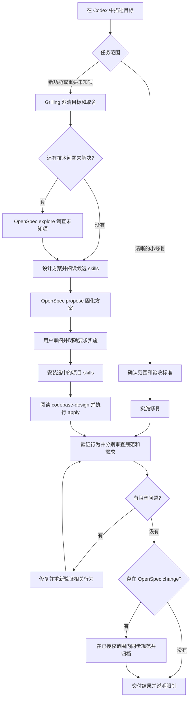
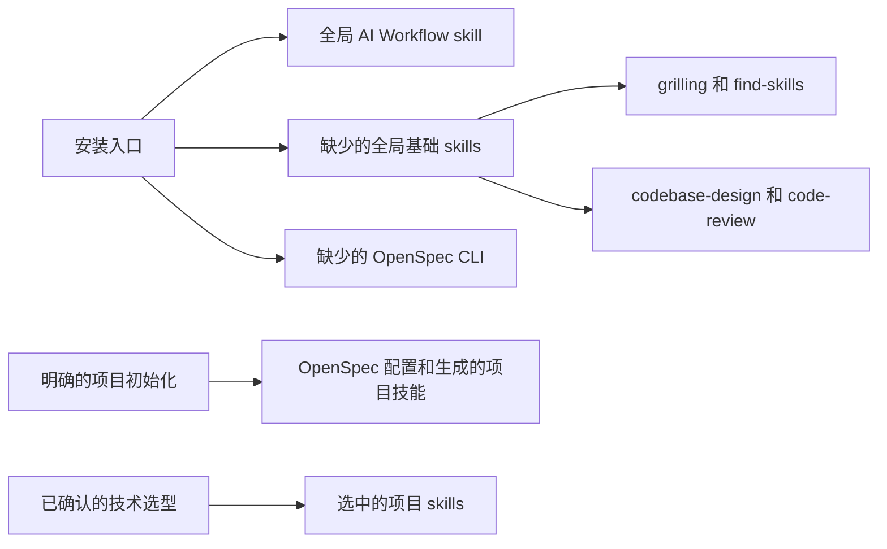

<div align="center">

# AI Workflow

**在 Codex 中，将明确的需求一路推进到经过验证的交付。**

[English](README.md) · [简体中文](README.zh-CN.md)

[](https://github.com/shuaibilx/AI-workflow-coding/actions/workflows/ci.yml)
[](LICENSE)
[](skills/ai-workflow/SKILL.md)

</div>

AI Workflow 是一个面向 Codex 的开发工作流 skill，串联需求澄清、技术选型、技能发现、OpenSpec 规划、实现和审查。它负责把各阶段的决策传递下去，并根据任务规模调整流程。

## 为什么做这个 skill

工具齐全之后，阶段之间仍可能脱节：需求访谈结束，规划时又问一遍；架构已经确定，才安装本该影响设计的技术 skill；审查只检查提交记录，却漏掉工作区中的实际实现。

这个工作流明确了这些衔接：

- **澄清一次，复用决策。** 只探索尚未解决的问题。
- **让经验参与方案设计。** 定稿前阅读候选 skill，之后再安装选中的项目技能。
- **保留一份实施计划。** 将访谈结论转入 OpenSpec 产物。
- **验证后再收尾。** 检查实际行为，分别审查规范和需求，修复问题后归档。
- **按任务规模分流。** 范围清晰的局部修复走简化路径。

OpenSpec 提供变更和规范管理机制，AI Workflow 负责将它与其他技能衔接起来。本项目为独立项目，第一版面向 Codex。

## 看一遍完整流程



完整流程在提案展示后等待用户明确启动实施。后续实施可以包含验证、审查与修复、规范同步和归档。实质性的范围变化返回决策步骤，常规步骤则在已有授权内连续推进。

## 快速开始

需要 **Codex、Node.js 22.20.0 或更高版本、npm 和 Git**。安装程序面向 Windows、macOS 和 Linux，CI 覆盖这三个系统。Windows 使用 PowerShell 7。

### 用标准 skills 命令安装

```sh
npx skills add https://github.com/shuaibilx/AI-workflow-coding --skill ai-workflow --global --agent codex
```

然后在 Codex 中打开你的项目，输入：

```text
$ai-workflow 安装缺少的依赖，并在当前项目初始化 OpenSpec。
然后帮我规划 CSV 导出功能，先澄清会影响方案的需求，再生成提案。
```

这条明确的初始化请求允许 Codex 运行随 skill 提供的安装程序。标准 `skills add` 命令安装主 skill 和配套文件，不会自动执行依赖安装钩子。

### 或者，一条命令安装主 skill 和全局依赖

```sh
npx --yes --package=github:shuaibilx/AI-workflow-coding ai-workflow install
```

该命令直接使用 GitHub 中的包，无需另行发布到 npm。它安装工作流以及缺少的基础技能和 OpenSpec CLI，保留已有依赖。项目初始化留到明确选定项目时进行。

### 提案确认后继续实施

```text
$ai-workflow 实施这个提案，包含验证、代码审查、修复，
在完成条件全部满足后同步规范并归档。
```

小修复可以直接说明：

```text
$ai-workflow 修复这个标签中的错别字，保持修改局部，并验证受影响的界面。
```

中断后可以继续：

```text
$ai-workflow 从现有状态继续 CSV 导出变更。
```

## 安装了什么



| 内容 | 位置与行为 |
| --- | --- |
| AI Workflow 和基础技能 | 用户 `.agents/skills/`；也检测旧位置 `.codex/skills/` 中的已有依赖 |
| OpenSpec CLI | npm 全局；保留已有 CLI |
| OpenSpec 项目文件 | 仅在明确选定的项目中初始化 |
| 技术栈专用技能 | 规划时选择，安装到项目 `.agents/skills/` |
| 安装器的托管记录 | 用户 `.ai-workflow/state.json`，与 skills CLI 的锁文件分开 |

第三方 skill 从各自上游仓库下载，来源和固定 Git commit 记录在 [dependencies.json](skills/ai-workflow/config/dependencies.json)。本 skill 不打包第三方源文件副本。

已有但不归本安装器托管的技能会被复用和保留，更新时也不会覆盖。目录存在不等于来源或兼容性已确认。安装器仅记录自己安装的依赖，并在更新托管内容前检查本地修改。

## 检查、初始化与更新

全局安装后，以下路径写法适用于 POSIX shell 和 PowerShell：

```sh
node "$HOME/.agents/skills/ai-workflow/scripts/cli.mjs" doctor
node "$HOME/.agents/skills/ai-workflow/scripts/cli.mjs" install --dry-run
node "$HOME/.agents/skills/ai-workflow/scripts/cli.mjs" init --project "/absolute/path/to/project"
```

Windows 的项目参数可写成 `C:/work/my-project`。使用自定义 Codex 安装位置或项目级技能时，先确定实际 skill 路径。

更新主 skill：

```sh
npx skills add https://github.com/shuaibilx/AI-workflow-coding --skill ai-workflow --global --agent codex
```

再更新本安装器托管的依赖：

```sh
node "$HOME/.agents/skills/ai-workflow/scripts/cli.mjs" update --dry-run
node "$HOME/.agents/skills/ai-workflow/scripts/cli.mjs" update
```

默认采用当前发布版声明的版本和 commit。显式添加 `--latest` 才跟随上游最新版本，该通道未经兼容性验证。日常开发不会自动升级依赖。

OpenSpec CLI 升级后，刷新项目内的生成指令是另一个明确操作：在目标项目执行 `openspec update`。安装器不会悄悄刷新所有项目。

## 主入口简短，阶段说明按需加载

```text
skills/ai-workflow/
├── SKILL.md                    路由和关键衔接规则
├── references/
│   ├── setup.md                安装、作用域和更新
│   ├── planning.md             澄清、设计和提案
│   ├── skill-selection.md      技能筛选和项目安装
│   ├── implementation.md       实施与范围变化
│   ├── review.md               验证、双轴审查和收尾
│   └── resume.md               恢复已有进度
├── scripts/                    跨平台安装程序
├── config/dependencies.json    带版本的依赖来源
└── agents/openai.yaml          Codex 界面元数据
```

Codex 进入相应阶段时读取对应说明，主入口不会一次加载全部流程，也不复制上游技能手册。

## 需要知道的边界

- **真正的 Plan mode 由宿主控制。** skill 只能使用实际提供的控制能力，不会声称靠一段文字就切换模式。
- **Explore 按需使用。** 需求和实现路径已经清晰时可以跳过。
- **审查范围要明确。** 未提交和未跟踪的实现需要补充审查；缺少 Git 或独立代理时，如实报告采用的替代方式。
- **审查通过不等于测试通过。** 完成判断需要与修改相匹配的实际证据。
- **发布和部署需要单独指令。** 完成开发不会自动推送或部署。

## 开发与分发

```sh
npm test
npm run check
npm pack --dry-run
```

包本身没有运行时 npm 依赖，需要时调用固定版本的外部工具。下载依赖的集成验证需要联网。发布和 Skills.sh 检查见 [发布说明](docs/publishing.md)。

Skills.sh 通过正常 `skills add` 安装产生的遥测发现公开 GitHub 技能。搜索和排名更新时间由服务决定，不保证立即收录。参见 [官方 FAQ](https://www.skills.sh/docs/faq)。

## 致谢与许可证

本项目衔接了 [OpenSpec](https://github.com/Fission-AI/OpenSpec)、[Matt Pocock 的 skills](https://github.com/mattpocock/skills) 和 [Vercel skills 生态](https://github.com/vercel-labs/skills)。第三方项目保留各自的许可证和发布周期。

本项目的工作流指令和安装程序采用 [MIT 许可证](LICENSE)。
