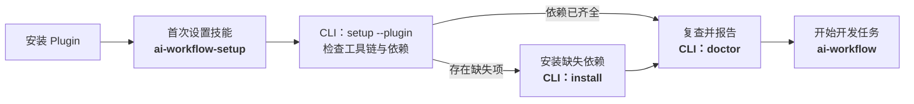

<div align="center">

# AI Workflow Plugin

**在 Codex 中，将明确的需求一路推进到经过验证的交付。**

[English](README.md) · [简体中文](README.zh-CN.md)

[](https://github.com/shuaibilx/AI-workflow-coding/actions/workflows/ci.yml)
[](LICENSE)
[](skills/ai-workflow/SKILL.md)

</div>

AI Workflow Plugin 为 Codex 提供从需求澄清、技术选型、技能发现到 OpenSpec 规划、实现、验证和审查的开发工作流。插件包含模块化的 `ai-workflow` skill、首次设置 skill 和依赖管理 CLI，负责传递各阶段的决策，并根据任务规模调整流程。

## 为什么做这个 skill

工具齐全之后，阶段之间仍可能脱节：需求访谈结束，规划时又问一遍；架构已经确定，才安装本该影响设计的技术 skill；审查只检查提交记录，却漏掉工作区中的实际实现。

这个工作流明确了这些衔接：

- **澄清一次，复用决策。** 只探索尚未解决的问题。
- **让经验参与方案设计。** 定稿前阅读候选 skill，之后再安装选中的项目技能。
- **保留一份实施计划。** 将访谈结论转入 OpenSpec 产物。
- **验证后再收尾。** 检查实际行为，分别审查规范和需求，修复问题后归档。
- **按任务规模分流。** 范围清晰的局部修复走简化路径。

OpenSpec 提供变更和规范管理机制，AI Workflow 负责将它与其他技能衔接起来。本项目为独立项目，第一版面向 Codex。

## 看一遍完整流程

```mermaid
%%{init: {"theme":"base","themeVariables":{"fontSize":"14px"},"flowchart":{"nodeSpacing":18,"rankSpacing":35,"wrappingWidth":180}}}%%
flowchart LR
    G[描述目标]:::start --> C["1. 澄清<br/><span style='color:#174ea6'><b>grilling</b></span> · 需求与验收<br/><span style='color:#174ea6'><b>Plan mode</b></span> · 复杂任务<br/><span style='color:#174ea6'><b>openspec-explore</b></span> · 未决事实"]:::stage
    C --> P["2. 规划与提案<br/><span style='color:#174ea6'><b>find-skills</b></span> · 技能匹配<br/><span style='color:#174ea6'><b>research</b></span> · 未确定的外部事实<br/><span style='color:#174ea6'><b>domain-modeling</b></span> · 长期术语/决策<br/><span style='color:#174ea6'><b>codebase-design</b></span> · 模块接口<br/><span style='color:#174ea6'><b>openspec-propose</b></span> · 决策与任务"]:::stage
    P -->|用户要求实施| I["3. 实施<br/><span style='color:#174ea6'><b>openspec-apply-change</b></span> · 任务<br/><span style='color:#174ea6'><b>tdd</b></span> · 已确认的测试 seam<br/><span style='color:#174ea6'><b>diagnosing-bugs</b></span> · 难复现 Bug/性能回退<br/><span style='color:#174ea6'><b>writing-for-agents</b></span> · 仅 agent 文档"]:::stage
    I --> V["4. 验证与收尾<br/>检查 · 行为<br/><span style='color:#174ea6'><b>code-review</b></span> · 规范与需求<br/><span style='color:#174ea6'><b>sync + archive</b></span> · 完整变更<br/><span style='color:#174ea6'><b>pr</b></span> · 仅起草 PR 文案"]:::stage
    G -->|小修复| I
    V -->|修复并复查| I
    G -.->|用户要求初始化仓库| R["可选 Git 设置<br/><span style='color:#174ea6'><b>delivery.md</b></span> · git init + origin"]:::optional
    R -.-> C
    V -.->|用户明确要求 GitHub 交付| D["可选 GitHub 交付<br/><span style='color:#174ea6'><b>create-pull-request</b></span> · commit/push 或创建 PR"]:::optional
    D -.->|用户明确要求持续跟进| M["已创建 PR 的跟进<br/><span style='color:#174ea6'><b>babysit-pr</b></span> · CI + 审查反馈"]:::optional
    G -.->|用户选择仓库配置| S["可选仓库引导<br/><span style='color:#174ea6'><b>setup-matt-pocock-skills</b></span> · tracker + 领域文档"]:::optional
    S -.-> C
    classDef start fill:#ffffff,stroke:#64748b,color:#334155,stroke-width:1.5px
    classDef stage fill:#f8fafc,stroke:#cbd5e1,color:#334155,stroke-width:1.5px
    classDef optional fill:#fff7ed,stroke:#f97316,color:#7c2d12,stroke-width:1.5px,stroke-dasharray:5 5
```



蓝色文字表示技能和工具，普通文字说明其作用和触发条件。虚线分支均为可选流程，需由用户主动触发。在新增的技能中，只有 `pr` 纳入常规全局依赖；其他任务专用技能在命中时安装到项目中。

Plan mode 是 Codex 的可选辅助模式，适用于复杂、有风险或需求尚不明确的任务；它不会产生第二份事实来源。只有仍有问题待查时，才用 `openspec-explore` 调查代码库事实或方案可行性。OpenSpec 提案记录已确认的决策、选中的技能、测试 seam 和任务，展示后等待用户要求实施。小修复直接进入实施和审查；完整变更在检查通过后同步规范并归档，然后起草 PR 文案；提交、push 和创建 PR 都是单独的可选动作。设计问题未解决时使用 `openspec-explore`；本工作流不路由到 `prototype`。

| 阶段 | 技能与工具 | 作用 |
| --- | --- | --- |
| 澄清 | `grilling`；Codex Plan mode（可选）；仍有未知时用 `openspec-explore` | 明确范围与验收；复杂任务时推演实现路径；调查尚未解决的代码库事实或可行性。 |
| 规划与提案 | `find-skills`；按需 `research`、`domain-modeling`；`codebase-design`；`openspec-propose` | 定稿前评估候选技能；需要时记录带引用的研究、长期领域术语和测试 seam，再生成唯一正式提案和任务计划。 |
| 实施 | `openspec-apply-change`；按需 `tdd`、`diagnosing-bugs`；仅编辑 agent 文档时用 `writing-for-agents` | 结合已确认的测试 seam、系统化 Bug 复现或 agent 文档规范完成任务。 |
| 验证与收尾 | 检查；`code-review`；`openspec-sync-specs`；`openspec-archive-change`；`pr` | 验证行为，在本地审查规范与需求，修复并复查问题，同步并归档完整变更，然后起草 PR 文案。 |
| 可选 Git 设置 | 用户明确要求时参考 `delivery.md` | 仅在用户要求仓库初始化时运行 `git init` 或添加 remote。 |
| 可选 GitHub 交付 | 用户明确要求时用 `create-pull-request` | 仅执行用户明确要求的操作：提交、push 或创建 PR。 |
| 可选 PR 跟进 | 用户明确要求时用 `babysit-pr` | 跟进已创建 PR 的 CI 和已发布审查反馈；按其安全规则修复时可能 push。 |
| 可选仓库引导 | 用户主动选择时使用 `setup-matt-pocock-skills` | 一次性配置更广泛的 Matt Pocock 工程约定；OpenSpec 不依赖它。 |

## 快速开始

需要 **Codex、Node.js 22.20.0 或更高版本、npm 和 Git**。安装程序面向 Windows、macOS 和 Linux，CI 覆盖这三个系统。Windows 使用 PowerShell 7。

### 从本仓库安装 Plugin

需要支持 `codex plugin` 命令的 Codex 版本：

```sh
codex plugin marketplace add shuaibilx/AI-workflow-coding
codex plugin add ai-workflow@ai-workflow-coding
```

安装后重启 Codex 或开启新对话，以加载插件技能。这是本仓库提供的 marketplace 安装渠道，不表示已经上架官方 Plugin Directory。

### 运行首次设置

如果客户端提供插件的 **Setup／设置** 操作，直接运行；也可以在 Codex 技能列表中选择 **AI Workflow Plugin Setup**，然后输入：

```text
$ai-workflow:ai-workflow-setup 安装缺少的依赖，并检查环境是否准备就绪。
```

插件技能使用上述命名空间，便于与独立安装版本区分。manifest 已声明 onboarding skill；未显示 Setup 按钮的客户端也可直接调用这个技能。



一次 setup 请求即授权完成缺失依赖的安装和最终复查，不会逐项重复询问。已有依赖会保留；主工作流直接使用 Plugin 内的版本，不再复制到全局 skill 目录。发现旧的独立安装入口时会提示并保留。如果缺少 Node/npm/Git，设置会停止并说明需要先解决的前置条件。安装 Plugin 本身不会执行全局依赖安装。

首次设置技能调用包内的单条命令 `setup --plugin --json`。CLI 负责“检查—安装—复查”并返回结构化结果，skill 负责解释结果、处理用户明确指定的项目。目录编排及借鉴 OpenSpec 的职责划分见 [Skill + CLI 架构说明](docs/architecture.md)。

如果还需要初始化 OpenSpec，请在 setup 请求中明确指定项目路径；否则首次设置只准备依赖。之后选择插件中的 **AI Workflow** 技能开始任务：

```text
$ai-workflow:ai-workflow 帮我澄清并规划当前项目的 CSV 导出功能。
```

### 也支持独立 skill 安装

```sh
npx skills add https://github.com/shuaibilx/AI-workflow-coding --skill ai-workflow --global --agent codex
```

然后在 Codex 中打开你的项目，输入：

```text
$ai-workflow 安装缺少的依赖，并在当前项目初始化 OpenSpec。
然后帮我规划 CSV 导出功能，先澄清会影响方案的需求，再生成提案。
```

这条明确的初始化请求允许 Codex 运行随 skill 提供的安装程序。标准 `skills add` 命令安装主 skill 和配套文件，不会自动执行依赖安装钩子。

### 或者，一条命令安装独立主 skill 和全局依赖

```sh
npx --yes --package=github:shuaibilx/AI-workflow-coding ai-workflow install
```

该命令直接使用 GitHub 中的包，无需另行发布到 npm。它安装工作流以及缺少的基础技能和 OpenSpec CLI，保留已有依赖。项目初始化留到明确选定项目时进行。

### 提案确认后继续实施

以下示例调用 Plugin 内的工作流；独立版安装则使用 `$ai-workflow`。

```text
$ai-workflow:ai-workflow 实施这个提案，包含验证、代码审查、修复，
在完成条件全部满足后同步规范并归档。
```

小修复可以直接说明：

```text
$ai-workflow:ai-workflow 修复这个标签中的错别字，保持修改局部，并验证受影响的界面。
```

中断后可以继续：

```text
$ai-workflow:ai-workflow 从现有状态继续 CSV 导出变更。
```

## 安装了什么

Plugin 携带主工作流与首次设置技能；setup 安装缺少的全局基础技能（`grilling`、`find-skills`、`codebase-design`、`code-review`、`pr`）和 OpenSpec CLI。任务专用技能及可选仓库配置另行处理：

| 内容 | 位置与行为 |
| --- | --- |
| Plugin 内的主工作流、setup 和 CLI | Codex 管理的插件安装目录，随 Plugin 更新 |
| 常规第三方技能 | 用户 `.agents/skills/`；也检测旧位置 `.codex/skills/` 中的已有依赖 |
| 独立版 AI Workflow（另一安装方式） | 用户 `.agents/skills/ai-workflow`；Plugin setup 不会创建或替换它 |
| OpenSpec CLI | npm 全局；保留已有 CLI |
| OpenSpec 项目文件 | 仅在明确选定的项目中初始化 |
| 任务专用技能（`tdd`、`diagnosing-bugs`、`research`、`domain-modeling`、`writing-for-agents`、`create-pull-request`、`babysit-pr` 或更匹配的候选项） | 按任务选择，获准后安装到项目 `.agents/skills/` |
| `setup-matt-pocock-skills` | 可选、由用户主动调用的一次性仓库引导；不是 OpenSpec 的前置条件 |
| 安装器的托管记录 | 用户 `.ai-workflow/state.json`，与 skills CLI 的锁文件分开 |

第三方 skill 从各自上游仓库下载，来源和固定 Git commit 记录在 [dependencies.json](skills/ai-workflow/config/dependencies.json)。本 Plugin 不打包第三方源文件副本。

完整流程默认使用 `pr` 根据最终 diff 和实际验证证据起草 PR 文案。提交、push 和创建 PR 是独立可选动作：`create-pull-request` 只执行用户明确要求的操作；只有用户要求持续跟进已创建 PR 时才使用 `babysit-pr`。Git 初始化由工作流自己的仓库引导说明处理，不增加额外依赖。其他新增 skill 仅在触发条件匹配时选择；可选 setup 将 issue tracker 留给 backlog/triage，不替代 OpenSpec 的变更计划。

已有但不归本安装器托管的技能会被复用和保留，更新时也不会覆盖。目录存在不等于来源或兼容性已确认。安装器仅记录自己安装的依赖，并在更新托管内容前检查本地修改。

## 检查、初始化与更新

**Plugin 安装**可以直接选择首次设置技能进行诊断或补装依赖。更新 Git marketplace 并安装其中当前的插件版本：

```sh
codex plugin marketplace upgrade ai-workflow-coding
codex plugin add ai-workflow@ai-workflow-coding
```

更新后重启 Codex 或开启新对话。本地路径 marketplace 则读取你的 checkout，需要先更新 checkout 再重新安装。依赖更新与 Plugin 更新分开：需要升级托管依赖时，让 Codex 调用包内 CLI 的 `update --plugin --dry-run`，再执行 `update --plugin`。setup 本身只补装缺失项，不升级已有依赖。

手动诊断 Plugin 时，先确定实际安装目录，再运行 `node "<plugin-path>/skills/ai-workflow/scripts/cli.mjs" doctor --plugin`。`--plugin` 要求有效的插件包，并避免复制或更新独立主 skill；自动化脚本中不要写死带版本号的缓存路径。

**独立版全局安装**后，以下路径写法适用于 POSIX shell 和 PowerShell：

```sh
node "$HOME/.agents/skills/ai-workflow/scripts/cli.mjs" doctor
node "$HOME/.agents/skills/ai-workflow/scripts/cli.mjs" install --dry-run
node "$HOME/.agents/skills/ai-workflow/scripts/cli.mjs" init --project "/absolute/path/to/project"
```

Windows 的项目参数可写成 `C:/work/my-project`。使用自定义 Codex 安装位置或项目级技能时，先确定实际 skill 路径。

使用 `skills` CLI，按名称更新通过该 CLI 安装的独立 skill；这些命令不更新 Plugin 内的技能。以下命令会全局更新独立工作流和常用基础 skill：

```sh
npx --yes --package=skills@1.7.4 skills update ai-workflow --global --yes
npx --yes --package=skills@1.7.4 skills update find-skills codebase-design code-review pr --global --yes
```

`skills update` 会使用安装时记录的来源。对于手动安装且没有来源记录的 skill（例如 `grilling`），从原仓库重新添加即可更新：

```sh
npx --yes --package=skills@1.7.4 skills add https://github.com/mattpocock/skills --skill grilling --global --agent codex --yes
```

更新会替换已安装的文件；如果你修改过 skill 内容，请先备份。

如需只更新由 AI Workflow 安装器记录为托管的依赖，运行：

```sh
node "$HOME/.agents/skills/ai-workflow/scripts/cli.mjs" update --dry-run
node "$HOME/.agents/skills/ai-workflow/scripts/cli.mjs" update
```

此命令只更新由本安装器安装并记录的依赖；已有但未托管的 skill 会保留。默认采用当前发布版声明的版本和 commit。显式添加 `--latest` 才跟随上游最新版本，该通道未经兼容性验证。日常开发不会自动升级依赖。

OpenSpec CLI 升级后，刷新项目内的生成指令是另一个明确操作：在目标项目执行 `openspec update`。安装器不会悄悄刷新所有项目。

## 主入口简短，阶段说明按需加载

Plugin 的入口为 `plugin.json`（通用 manifest）、`.codex-plugin/plugin.json`（Codex 兼容配置）和 `.agents/plugins/marketplace.json`（仓库 marketplace）。`skills/ai-workflow-setup/` 是首次设置技能；主工作流继续保持模块化结构：

```text
skills/ai-workflow/
├── SKILL.md                    路由和关键衔接规则
├── references/
│   ├── setup.md                安装、作用域和更新
│   ├── planning.md             澄清、设计和提案
│   ├── skill-selection.md      技能筛选和项目安装
│   ├── implementation.md       实施与范围变化
│   ├── review.md               验证、双轴审查和收尾
│   ├── delivery.md             Git 初始化与可选 GitHub 交付
│   └── resume.md               恢复已有进度
├── scripts/                    跨平台安装程序
├── config/dependencies.json    带版本的依赖来源
└── agents/openai.yaml          Codex 界面元数据
```

Codex 进入相应阶段时读取对应说明，主入口不会一次加载全部流程，也不复制上游技能手册。

## 需要知道的边界

- **Plan mode 由宿主控制且按需使用。** OpenSpec 提案是唯一持久计划。
- **Explore 按需使用。** 需求和实现路径已经清晰时可以跳过。
- **审查范围要明确。** 未提交和未跟踪的实现需要补充审查；缺少 Git 或独立代理时，如实报告采用的替代方式。
- **审查通过不等于测试通过。** 完成判断需要与修改相匹配的实际证据。
- **发布和部署需要单独指令。** 完成开发不会自动推送或部署。

## 开发与分发

```sh
npm test
npm run check
npm run test:integration
npm pack --dry-run
```

包本身没有运行时 npm 依赖，需要时调用固定版本的外部工具。下载依赖的集成验证需要联网。发布和 Skills.sh 检查见 [发布说明](docs/publishing.md)。

流程图使用直接嵌入 README 的 Mermaid 代码，由 GitHub 渲染。修改时保持中英文图表对应。

Skills.sh 通过正常 `skills add` 安装产生的遥测发现公开 GitHub 技能。搜索和排名更新时间由服务决定，不保证立即收录。参见 [官方 FAQ](https://www.skills.sh/docs/faq)。

## 致谢与许可证

本项目衔接了 [OpenSpec](https://github.com/Fission-AI/OpenSpec)、[Matt Pocock 的 skills](https://github.com/mattpocock/skills) 和 [Vercel skills 生态](https://github.com/vercel-labs/skills)。第三方项目保留各自的许可证和发布周期。

本项目的工作流指令和安装程序采用 [MIT 许可证](LICENSE)。
